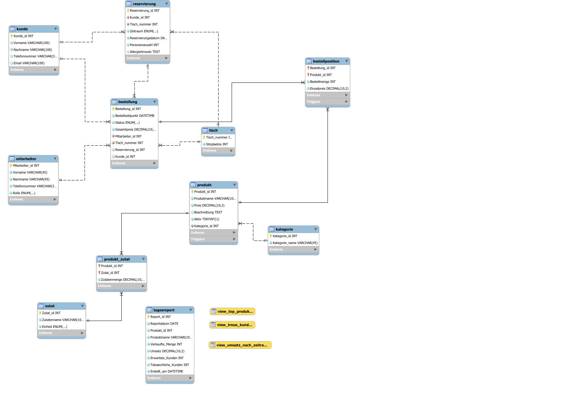

# Luigi Pizzeria – Relationale Datenbank mit Webanwendung

Datenbankprojekt im Modul **Datenbanksysteme** an der Hochschule Fulda (Sommersemester 2026).

Die Datenbank bildet den Betrieb einer Pizzeria ab: Kunden, Mitarbeiter, Tische, Reservierungen, Produkte mit Kategorien und Zutaten sowie Bestellungen mit Bestellpositionen. Darauf aufbauend ermöglicht sie Auswertungen zu Umsätzen, Produktverkäufen, Kundenzahlen und Tischbelegungen. Eine kleine Webanwendung (Node.js/Express) dient als Manager-Oberfläche.

## Verwendete Technologien

- MySQL 8, MySQL Workbench
- SQL: DDL, DML, Views, Trigger, Stored Procedures, Functions, Events, Indizes, Transaktionen
- Node.js, Express, mysql2
- HTML, CSS, JavaScript

## Datenmodell



Das Modell umfasst 10 Tabellen und ist bis zur **3. Normalform** normalisiert. Die N:M-Beziehungen zwischen Bestellung und Produkt sowie zwischen Produkt und Zutat werden über die Zwischentabellen `Bestellposition` und `Produkt_Zutat` aufgelöst.

Wichtige Entwurfsentscheidungen:

- **Künstliche Primärschlüssel** (z. B. `Kunde_id`, `Bestellung_id`), damit Beziehungen stabil bleiben, auch wenn sich Namen ändern.
- **Fremdschlüssel** mit bewusst gewählten `ON DELETE`/`ON UPDATE`-Regeln sichern die referenzielle Integrität.
- **CHECK-Constraints** setzen Geschäftsregeln direkt in der Datenbank durch (z. B. Preis > 0, mindestens Telefonnummer oder E-Mail beim Kunden).
- Der **Einzelpreis wird in der Bestellposition gespeichert**, damit abgeschlossene Bestellungen auch nach späteren Preisänderungen korrekt bleiben.
- Eine **UNIQUE-Constraint** auf (Tisch, Datum, Zeitraum) verhindert Doppelreservierungen.

Der vollständige Anwendungskontext und alle Geschäftsregeln stehen in [docs/Anwendungskontext_und_Geschaeftsregeln.pdf](docs/Anwendungskontext_und_Geschaeftsregeln.pdf).

## Funktionen der Datenbank

**Trigger**
- Automatische Berechnung des Gesamtpreises einer Bestellung bei INSERT, UPDATE und DELETE von Bestellpositionen
- Sperre von Preisänderungen, solange ein Produkt in einer offenen Bestellung enthalten ist

**Stored Procedure mit Transaktion**
- `sp_bestellung_anlegen`: prüft Tisch, Mitarbeiter, Produkt und Menge und legt Bestellung und erste Bestellposition innerhalb einer Transaktion an (COMMIT bei Erfolg, ROLLBACK bei Fehler, Sperre mit `SELECT … FOR UPDATE`)

**Functions**
- `fn_anzahl_freie_tische`: freie Tische für ein Datum und einen Zeitraum
- `fn_anzahl_erwartete_gaeste`: erwartete Gäste für ein Datum und einen Zeitraum

**Event**
- `ev_tagesreport_erstellen`: erzeugt automatisch einen Tagesreport mit Verkaufsmengen, Umsätzen sowie erwarteten und tatsächlich erschienenen Gästen

**Views**
- Umsatz nach Reservierungszeitraum, Stammkunden, Top-Produkte, offene Bestellungen

**Indizes und Query-Optimierung**
- Gezielte Indizes für die Suchspalten der Trigger, Prozeduren, Functions und Events, analysiert mit `EXPLAIN`
- Berücksichtigung der Linksregel bei zusammengesetzten Indizes und Verzicht auf redundante Indizes

**Auswertungen (komplexe SELECT-Statements)**
- Wochentage mit den meisten Bestellungen
- Umsatz pro Mitarbeiter und Mitarbeiter mit überdurchschnittlichem Umsatz
- Kategorien mit überdurchschnittlichem Positionswert
- Am wenigsten bestellte Produkte
- Kunden mit Reservierung, die nicht erschienen sind

## Projektstruktur

```text
luigi-pizzeria-datenbank/
├── sql/
│   ├── 01_tabellen_erstellen.sql   Datenbank und Tabellen
│   ├── 02_stored_programs.sql      Trigger, Procedure, Functions, Event
│   ├── 03_beispieldaten.sql        Fiktive Testdaten
│   ├── 04_views.sql                Views
│   ├── 05_indizes.sql              Indizes
│   └── 06_auswertungen.sql         Komplexe SELECT-Statements
├── docs/
│   ├── EER_Diagramm.png / .pdf
│   └── Anwendungskontext_und_Geschaeftsregeln.pdf
└── frontend/                       Webanwendung (Node.js/Express)
```

## Installation

### 1. Datenbank einrichten

Die SQL-Skripte in MySQL Workbench **in der Reihenfolge der Nummerierung** ausführen (01 bis 06). Die Stored Programs (02) müssen vor den Beispieldaten (03) angelegt werden, damit die Trigger den Gesamtpreis der Bestellungen berechnen.

### 2. Webanwendung starten

Voraussetzung: Node.js ist installiert.

```bash
cd frontend
npm install
```

Die MySQL-Zugangsdaten werden über Umgebungsvariablen übergeben:

```bash
# Linux / macOS
DB_USER=root DB_PASSWORD=dein_passwort node app.js

# Windows (PowerShell)
$env:DB_USER="root"; $env:DB_PASSWORD="dein_passwort"; node app.js
```

Danach ist die Anwendung unter http://localhost:8080 erreichbar.

## Team

Gruppenprojekt, umgesetzt von **Line Stella Jiokeng** und **Lorie Laure Manfouo**.

## Hinweis

Alle Kunden-, Mitarbeiter- und Bestelldaten sind frei erfunden und dienen ausschließlich zu Testzwecken.
